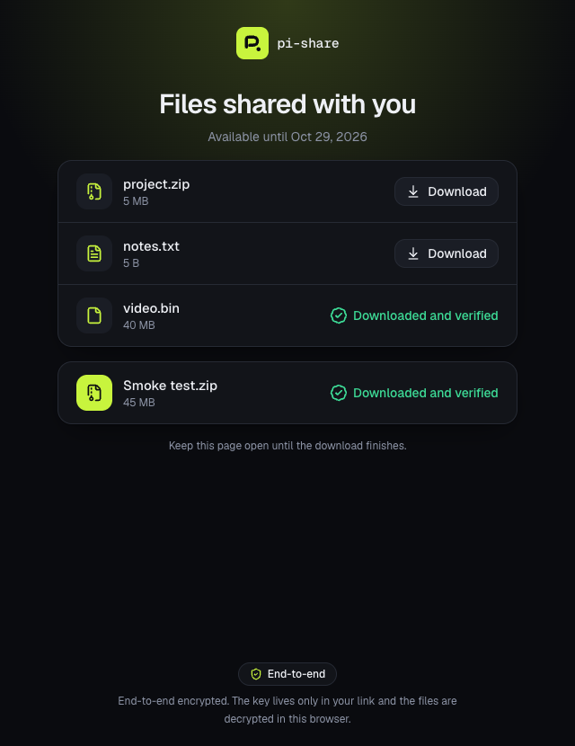
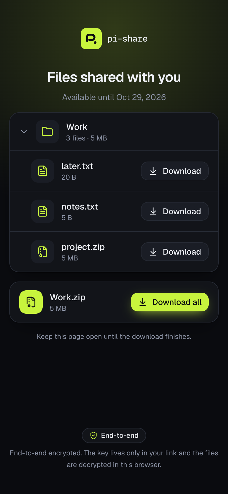
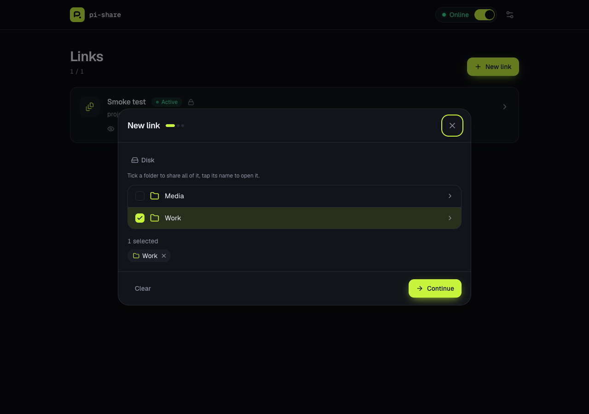
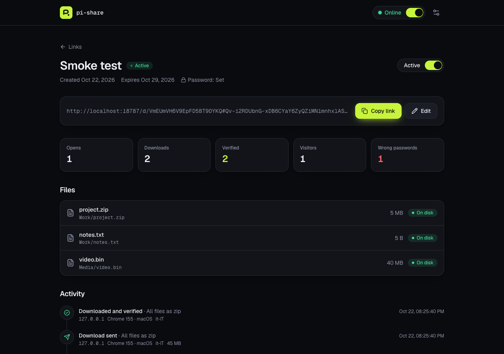
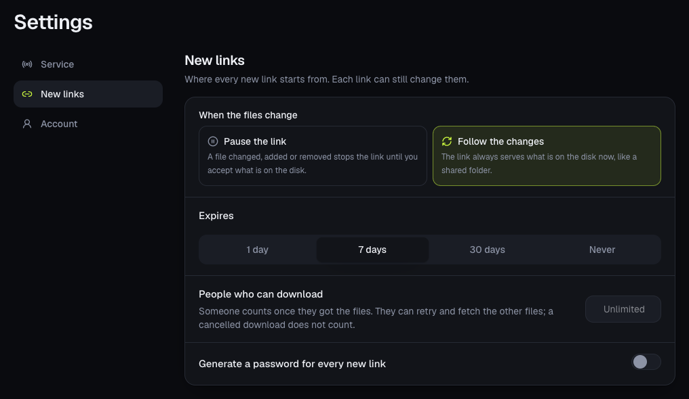
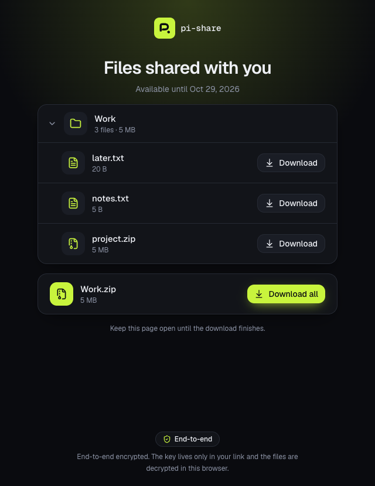
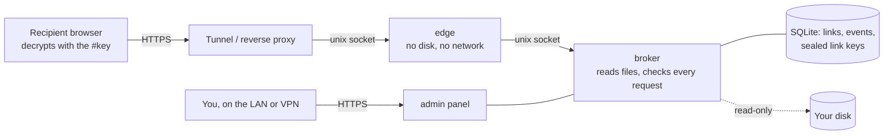

<div align="center">


# pi-share

**Private, end-to-end encrypted links to the files and folders already on your disk.**<br />
Self-hosted on a Raspberry Pi or anything that runs Docker. No uploads, no third-party storage.

[](https://github.com/ontech7/pi-share/actions/workflows/ci.yml)
[](https://github.com/ontech7/pi-share/actions/workflows/codeql.yml)
[](CHANGELOG.md)


<br />


[](https://github.com/ontech7/pi-share/pkgs/container/pi-share)
[](LICENSE)

[Features](#features) · [Screenshots](#screenshots) · [Quick start](#quick-start) · [Updates](#updates) ·
[How it works](#how-it-works) ·
[Security](#security-model) · [Configuration](#configuration) · [Changelog](CHANGELOG.md)

<br />


&nbsp;


</div>

## Why

Some files should not travel through somebody else's cloud:
- **Work files too big for chat.** A contract draft or a client export is over the chat app's size limit, and it is
  **confidential**: it should not sit in a third-party bucket for weeks after the call.
- **A whole holiday folder for the family.** Gigabytes of photos and videos straight from your disk, **no
  compressing, no uploading**, and no account for anyone to create.
- **Documents for an accountant or a lawyer.** Scans, payslips and tax returns that must arrive intact, **expire
  after a week** and be downloaded by **one person only**.

pi-share turns any file or folder on your own disk into a link. **Nothing is uploaded**: the bytes leave your
machine only when the recipient downloads them, **encrypted end to end**, and you see **who opened what, and
when**.

## Features

**Share**
- **Files and folders in place.** Pick them in the admin panel and get a link; nothing is copied. Recipients browse
  folders as a tree and download single files or everything as one zip.
- **Gigabytes are fine.** Files stream from disk and are decrypted by a service worker straight into the
  recipient's download folder; "download all" builds a ZIP64 archive on the fly.
- **Live folders.** Per link you decide what a change on disk does: **pause** the link until you review and accept
  the list of added, removed and changed files, or **follow** the disk like a shared folder.

**Protect**
- **End-to-end encryption.** The key lives only in the link's `#fragment`, which browsers never send to a server.
  The recipient's browser decrypts and verifies every byte; tunnels and CDNs see ciphertext only.
- **Password, expiry and a limit on how many people may download**, with a lock after repeated wrong passwords.
  Whoever already downloaded may always come back; a cancelled download never counts.
- **One isolated service on the internet.** The public process has no disk, no database and no network: it only
  talks to the broker over a unix socket. The admin stays on your LAN or VPN.

**Stay in control**
- **Know what happened.** Opens, wrong passwords, downloads started, completed, interrupted and verified in the
  browser, each with time, IP, country, browser, OS and language. Chat-app link previews are logged apart.
- **Disable, re-enable or delete** a link at any time; moved or deleted files are detected.
- **Off when not in use.** One switch takes the public page offline, and it can switch itself off when no link
  is active.
- English and Italian, light and dark themes, made for phones too.

## Screenshots

| Pick files or folders                                                                  | Follow every link                                                                        |
| -------------------------------------------------------------------------------------- | ---------------------------------------------------------------------------------------- |
|               |  |
| **Settings**                                                                           | **Recipient page**                                                                       |
|  |     |

## Quick start

You need Docker with Compose and a way to reach the edge socket from the internet. The examples use a
[Cloudflare Tunnel](https://developers.cloudflare.com/cloudflare-one/connections/connect-networks/), which needs no
open port on your router. Images for `amd64` and `arm64` (any Raspberry Pi 4 or 5) are published on
[GitHub's registry](https://github.com/ontech7/pi-share/pkgs/container/pi-share) for every release.

```sh
mkdir pi-share && cd pi-share
curl -fsSLO https://raw.githubusercontent.com/ontech7/pi-share/main/compose.yaml
curl -fsSL -o .env https://raw.githubusercontent.com/ontech7/pi-share/main/.env.example
nano .env                       # set PUBLIC_URL, STORAGE_PATH, DATA_PATH
sudo install -d -o 10001 -g 10001 -m 0750 /run/pi-share/broker /run/pi-share/edge /var/lib/pi-share
docker compose up -d
docker compose logs admin | grep "setup code"
```

1. Open the admin (by default on `127.0.0.1:8080`; put it behind your LAN reverse proxy), enter the setup code from
   the logs and choose the admin password.
2. Point the tunnel at the edge socket. In the Cloudflare dashboard add a published application with service type
   **UNIX** and path `/run/pi-share/edge/edge.sock`, or in a locally managed `config.yml`:

   ```yaml
   ingress:
     - hostname: share.example.com
       service: unix:/run/pi-share/edge/edge.sock
     - service: http_status:404
   ```
3. `/run` is cleared at boot: add `d /run/pi-share/broker 0750 10001 10001 -` and the same line for `edge` to
   `/etc/tmpfiles.d/pi-share.conf`.

To update, change `PI_SHARE_IMAGE` in `.env` (or keep `:0.3` for every 0.3.x) and run
`docker compose pull && docker compose up -d`. Each image carries a signed build provenance:
`gh attestation verify oci://ghcr.io/ontech7/pi-share:0.4.0 --repo ontech7/pi-share` proves it was built by this
repository's workflow from the tagged commit. To build it yourself instead, `docker build -t pi-share:local .` in a
clone and set `PI_SHARE_IMAGE=pi-share:local`.

> [!TIP]
> The containers run as uid `10001`. If some of your folders are readable only by their owner, run them as that
> user instead (`user:` in `compose.yaml`); pi-share tells you clearly when it may not read a folder.

## Updates

The admin shows the running version and, unless you turn it off, asks GitHub every few hours which is the latest
release (nothing else is sent). A newer one appears next to the logo and in **Settings → Updates**, with its
notes. With the optional updater on the host, one click installs it; without it, the page shows the two commands
to run.

The updater is the only piece that runs as root, because it drives Docker: the admin never gets the Docker
socket. The admin can only leave a version number in a folder, and the updater decides everything again by itself:
- it reads nothing but that version (no symlinks, no special files, a few bytes at most) and echoes nothing back;
- the version must be a published, non-prerelease release of this repository, newer than the running one;
- the image must declare this repository and that version and runs pinned by digest; with the GitHub CLI and a
  token, its build provenance is verified too: built by the release workflow, from that version's tag
  (`VERIFY_PROVENANCE=required` makes it mandatory);
- the database is copied first (when there is room for it), and if the new version is not healthy within two
  minutes, or the run is stopped half-way, the previous image and database come back. An update a power cut
  interrupted is undone at the next boot.

<details>
<summary><strong>Install the updater</strong></summary>

Read [`contrib/updater`](contrib/updater) first: it runs as root. The defaults expect `compose.yaml`,
[`compose.updater.yaml`](contrib/updater/compose.updater.yaml) and `.env` in `/etc/pi-share`; elsewhere, change the
paths in `updater.env` and `ReadWritePaths` in the service. `PI_SHARE_IMAGE` in `.env` can name a full version
(`0.4.0`) or a moving one (`0.4`); after the first update it is pinned to the exact version and digest.

```sh
sudo install -m 0755 -D contrib/updater/pi-share-updater.py /usr/local/lib/pi-share/pi-share-updater.py
sudo install -m 0644 contrib/updater/updater.env.example /etc/pi-share/updater.env
sudo install -m 0644 contrib/updater/pi-share-updater.path contrib/updater/pi-share-updater.service /etc/systemd/system/
sudo install -d -o 10001 -g 10001 -m 0750 /var/lib/pi-share-update/request
sudo install -d -m 0755 /var/lib/pi-share-update/status
sudo install -d -m 0700 /var/lib/pi-share-update/backup /var/lib/pi-share-update/docker /var/lib/pi-share-update/gh
sudo systemctl daemon-reload && sudo systemctl enable pi-share-updater.service
sudo systemctl enable --now pi-share-updater.path
cd /etc/pi-share && docker compose -f compose.yaml -f compose.updater.yaml up -d
```

</details>

## How it works



| Process    | Reachable from                         | Can access                                                                      |
| ---------- | -------------------------------------- | ------------------------------------------------------------------------------- |
| **edge**   | the internet, through your tunnel      | only the broker socket. No disk, no database, no network (`network_mode: none`) |
| **broker** | only the edge, through a unix socket   | the disk (read-only) and the database                                           |
| **admin**  | your LAN / VPN only, behind a password | the same process as the broker                                                  |

The edge forwards requests and serves the static recipient page. Every decision (is the link active, is the
ticket valid, is the file still the same) is taken again by the broker on each request.

### Encryption

- Each link gets a random 256-bit key `K`, shown to you once in the link (`https://…/d/<id>#<K>`) and kept in the
  database sealed with a master key (AES-256-GCM).
- File names, sizes and expiry reach the recipient encrypted with `HKDF(K, "meta")`.
- Files stream as 64 KiB records, each sealed with AES-256-GCM under `HKDF(K, salt, "file/<id>/<part>")`. The salt
  is fresh for every download and the nonce is a counter plus a last-record flag, so records cannot be reordered,
  dropped or truncated without the recipient noticing.
- To open a link the browser proves it holds `K` (an HMAC of the link id): knowing the id alone opens, logs and
  locks nothing.
- Passwords never leave the browser. It sends `HMAC(HKDF(K, "password"), PBKDF2-SHA256(password, 600k))`, stored
  as a scrypt hash, so someone watching the traffic cannot guess the password offline without `K`.
- Downloads need a short-lived ticket signed by the server, bound to the visitor and to the current password.

## Security model

| Who                                                 | What they get                                                                                       |
| --------------------------------------------------- | --------------------------------------------------------------------------------------------------- |
| Someone on the internet without the link            | Nothing. Unknown ids look exactly like disabled links, scanners get blocked.                        |
| The tunnel / CDN provider                           | Ciphertext, link ids, timing and approximate sizes. Never names, keys or passwords.                 |
| Someone who has the link (and the password, if set) | The linked files, until you disable the link, it expires or reaches its limit.                      |
| A compromised edge process                          | The broker's narrow API: no listing of links, no files outside a link, no keys.                     |
| Someone on your LAN                                 | The login page, rate-limited, unless you restrict the admin further (`ADMIN_ALLOW`, `ADMIN_HOSTS`). |
| Someone with root on the host                       | Everything. pi-share protects data in transit and at the edge, not from the machine's owner.        |

<details>
<summary><strong>Known limits, by design</strong></summary>

- Sizes are not padded, so an observer of the encrypted stream learns how big the files are.
- The key proof is the same for every request of a link: whoever can read the decrypted traffic of a link (the
  tunnel provider) could replay it to burn the password attempts and lock that link. Such a party can block the
  traffic anyway.
- The download limit counts people, not downloads. A visitor counts once they got the files: a complete download,
  or one stopped within the last 64 KiB record. Every download starts from the first byte, so stopping early on
  purpose never yields the end of a file. Whoever already counts may retry and fetch the other files; someone new
  finds the link exhausted, and so does someone who drops the visitor cookie, which lasts a year. People
  downloading for the first time hold their place until they finish.
- A file counts as unchanged while its size and modification time are the same. Someone who can write to the disk
  and restore both after editing could serve new content without the link noticing; that person already owns the
  files.
- Folders are listed again at most every few seconds and hold up to 20,000 entries (10,000 files per link). Names
  with backslashes, control or bidirectional characters are left out, and `:*?"<>|` become `_` in what the
  recipient sees, so an archive extracts the same on every system.

</details>

Before each release the code goes through an independent security review: a separate reviewer reads the code
without the author's notes. The reviews so far found and confirmed, among others, an authentication bypass,
proxy-header spoofing, a way around download limits, a symlink race and unbounded folder walks. All were fixed and
each has a regression test in [`test/security.test.ts`](test/security.test.ts) or
[`test/folders.test.ts`](test/folders.test.ts). To report a vulnerability, see [`SECURITY.md`](SECURITY.md).

## Quality

Every push runs these checks, and they must pass before anything is merged:

| Check                            | What it covers                                                                                                                                                                                                                                                 |
| -------------------------------- | -------------------------------------------------------------------------------------------------------------------------------------------------------------------------------------------------------------------------------------------------------------- |
| **Lint and types**               | Biome (recommended rules) and TypeScript strict mode on server, browser and tests                                                                                                                                                                              |
| **Unit and integration tests**   | Vitest: wire format round trips at every record boundary, tampering and truncation, ZIP64 output checked with `zipfile` and `unzip -t`, path traversal and symlinks, live folders, download limits, the full admin → edge → broker flow over real unix sockets |
| **Security regression tests**    | one test per issue found in the reviews                                                                                                                                                                                                                        |
| **Coverage gate**                | the build fails under 85% statements / 72% branches of `src/server` and `src/shared`                                                                                                                                                                           |
| **End to end in a real browser** | headless Chrome sets up the admin, creates a link, unlocks it, downloads through the service worker and compares the SHA-256 of the saved file with the original, shares a live folder, saves the settings                                                     |
| **CodeQL**                       | GitHub's security-extended queries, weekly and on every push                                                                                                                                                                                                   |
| **Multi-arch image**             | `linux/amd64` and `linux/arm64`, published with build provenance on every release                                                                                                                                                                              |

## Configuration

| Variable                                           | Default                             | Meaning                                                                                  |
| -------------------------------------------------- | ----------------------------------- | ---------------------------------------------------------------------------------------- |
| `PUBLIC_URL`                                       | `http://localhost:8787`             | Base of the links, as recipients see it                                                  |
| `STORAGE_ROOT`                                     | `/storage`                          | Folder whose files can be shared (mount it read-only)                                    |
| `DATA_DIR`                                         | `/data`                             | Database and master key. Back it up: losing the master key breaks existing links         |
| `DENY_PATHS`                                       |                                     | Comma-separated folders, relative to the root, that can never be browsed or shared       |
| `HIDE_SYSTEM`                                      | `true`                              | Hide names starting with `.` or `$` and system folders                                   |
| `SENSITIVE_FILE`                                   |                                     | File of `sha256 size [path]` lines; sharing a match asks for confirmation                |
| `ADMIN_LISTEN` / `BROKER_LISTEN` / `PUBLIC_LISTEN` | see `compose.yaml`                  | `host:port` or `unix:/path`                                                              |
| `BROKER_URL`                                       | `127.0.0.1:8081`                    | Where the edge finds the broker                                                          |
| `BROKER_SECRET_FILE`                               |                                     | Optional shared secret between edge and broker, on top of socket permissions             |
| `ADMIN_ALLOW`                                      | private ranges                      | Networks allowed to reach the admin                                                      |
| `ADMIN_HOSTS`                                      |                                     | If set, the admin answers only to these `Host` names (protects against DNS rebinding)    |
| `TRUSTED_PROXIES`                                  |                                     | Addresses of the reverse proxy in front of the admin, whose `X-Forwarded-For` is trusted |
| `CLIENT_IP_HEADER` / `COUNTRY_HEADER`              | `cf-connecting-ip` / `cf-ipcountry` | Headers set by your tunnel                                                               |
| `DEFAULT_EXPIRY_DAYS`                              | `7`                                 | Expiry preselected for new links until you choose one in the settings                    |
| `MAX_PASSWORD_FAILURES`                            | `10`                                | Wrong passwords before a link locks                                                      |
| `EVENT_RETENTION_DAYS`                             | `365`                               | Older activity is deleted                                                                |
| `ADMIN_LANG`                                       |                                     | `en` or `it`; empty follows the browser                                                  |

Everything else (what a change on disk does, expiry, download limit, generated password for new links, the
service switch) lives in the admin's **Settings**.

## Troubleshooting

<details>
<summary><strong>Downloads through the tunnel are slow</strong></summary>

Check the speed on the machine first: `curl --unix-socket /run/pi-share/edge/edge.sock …` serves gigabytes per
minute, so the bottleneck is almost always the tunnel.
- Keep `cloudflared` up to date and, if QUIC is slow on your connection, force HTTP/2 with
  `TUNNEL_TRANSPORT_PROTOCOL=http2` (or `--protocol http2`).
- Cloudflare picks the data center by the recipient's network. Some ISPs route to a distant one now and then; the
  `cf-ray` response header ends with its code. Recipients on other networks are not affected.

</details>

<details>
<summary><strong>"pi-share may not read this folder"</strong></summary>

The folder's permissions exclude the user the containers run as. Run them as the files' owner, or give that
user read access.

</details>

## Development

```sh
pnpm install
pnpm test                 # unit and integration tests
pnpm test:coverage        # with the coverage gate
pnpm typecheck && pnpm lint
pnpm build && pnpm e2e    # real browser, screenshots in e2e/.out/shots
```

**Stack:** Node 22 running TypeScript natively, Fastify, Drizzle on SQLite, Zod, React 19, TanStack Query,
Tailwind CSS 4, Vite, Vitest, Biome.

```text
src/server   edge, broker and admin (Fastify), storage, crypto, ZIP64 streaming
src/shared   wire format and API types shared with the browser
src/web      admin panel, recipient page and its service worker (React)
test         unit, integration and security regression tests
e2e          real-browser smoke test
```

Conventions and security invariants for contributors are in [`CLAUDE.md`](CLAUDE.md); releases are listed in the
[changelog](CHANGELOG.md). A `v*` tag on `main` publishes the image and the GitHub release.

## License

[MIT](LICENSE) © ontech7
