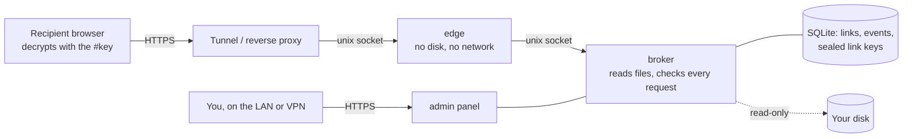

<div align="center">

# pi-share

**Private, end-to-end encrypted links to files that already live on your disk.**
Self-hosted on a Raspberry Pi (or anything that runs Docker). No uploads, no third-party storage.

[](https://github.com/ontech7/pi-share/actions/workflows/ci.yml)
[](https://github.com/ontech7/pi-share/actions/workflows/codeql.yml)


</div>

## Why

A colleague needs a 45 MB zip, the chat app stops at 20 MB, and the file is confidential, so it should not sit in
somebody else's bucket. pi-share turns any file on your own disk into a link: the file never leaves your machine
until the recipient downloads it, and the bytes travel encrypted end to end.

## What it does

- **Link files and folders in place.** Pick files or whole folders from your disk in the admin panel and get a link.
  Nothing is copied. The recipient browses folders as a tree and downloads single files or everything as a zip.
- **End-to-end encryption.** The key lives only in the link's `#fragment`, which browsers never send to a server.
  The recipient's browser decrypts and verifies every byte. Proxies, CDNs and tunnels see only ciphertext.
- **Optional password, expiry and a limit on how many people may download** per link, with a lock after repeated wrong passwords.
- **Know what happened.** Every open, wrong password, download start, completion, interruption and in-browser
  integrity check is logged with time, IP, country, browser, OS and language. Link previews from chat apps are
  logged separately.
- **Stay in control.** Disable, re-enable or delete a link at any time. Every linked file and folder is compared
  with what it held when the link was made. Per link you choose what a change does: **pause** the link until you
  review and accept the list of added, removed and changed files, or **follow** the disk like a shared folder.
  Defaults for new links (this policy, expiry, download limit, generated password) live in the settings.
- **Gigabytes are fine.** Files stream from disk and are decrypted in a service worker straight to the
  recipient's download folder; "download all" builds a ZIP64 archive on the fly.
- **Off when not in use.** One switch takes the public page offline, and it can go offline by itself when no link
  is active.
- English and Italian, light and dark themes, works on phones.

| Pick files                                                  | Activity                                                        |
| ----------------------------------------------------------- | --------------------------------------------------------------- |
|  |  |

## How it works



Three processes, two containers:

| Process    | Reachable from                         | Can access                                                                      |
| ---------- | -------------------------------------- | ------------------------------------------------------------------------------- |
| **edge**   | the internet, through your tunnel      | only the broker socket. No disk, no database, no network (`network_mode: none`) |
| **broker** | only the edge, through a unix socket   | the disk (read-only) and the database                                           |
| **admin**  | your LAN / VPN only, behind a password | the same process as the broker                                                  |

The edge forwards requests and serves the static recipient page; every decision (is the link active, is the
ticket valid, is the file still the same) is taken again by the broker on each request.

### How the encryption works

- Each link gets a random 256-bit key `K`. It is shown to you once in the link (`https://…/d/<id>#<K>`) and kept in
  the database sealed with a master key (AES-256-GCM).
- File names, sizes and expiry are sent to the recipient encrypted with `HKDF(K, "meta")`.
- A file is streamed as records of 64 KiB, each sealed with AES-256-GCM under `HKDF(K, salt, "file/<id>/<part>")`.
  The salt is fresh for every download and the nonce is a counter plus a last-record flag, so records cannot be
  reordered, dropped or truncated without the recipient noticing.
- To open a link the browser proves it holds `K` (an HMAC of the link id), so knowing the id alone opens, logs and
  locks nothing.
- Passwords never leave the browser: it sends `HMAC(HKDF(K, "password"), PBKDF2-SHA256(password, 600k))`, which the
  server stores as a scrypt hash. Someone watching the traffic cannot guess the password offline without `K`.
- Downloads need a short-lived ticket signed by the server and bound to the visitor and to the current password.

### Threat model, honestly

| Who                                                 | What they get                                                                                       |
| --------------------------------------------------- | --------------------------------------------------------------------------------------------------- |
| Someone on the internet without the link            | Nothing. Unknown ids look exactly like disabled links, scanners get blocked.                        |
| The tunnel / CDN provider                           | Ciphertext, link ids, timing and approximate sizes. Never names, keys or passwords.                 |
| Someone who has the link (and the password, if set) | The linked files, until you disable the link, it expires or hits its limit.                         |
| A compromised edge process                          | The broker's narrow API: no listing of links, no files outside a link, no keys.                     |
| Someone on your LAN                                 | The login page, rate-limited, unless you restrict the admin further (`ADMIN_ALLOW`, `ADMIN_HOSTS`). |
| Someone with root on the host                       | Everything. pi-share protects data in transit and at the edge, not from the machine's owner.        |

Known limits, by design:
- Sizes are not padded, so an observer of the encrypted stream learns how big the files are.
- The key proof is the same for every request of a link: whoever can read the decrypted traffic of a link
  (the tunnel provider) could replay it to burn the password attempts and lock that link. Such a party can block
  the traffic anyway.
- The download limit counts people, not downloads: a visitor counts once they got the files (a complete
  download, or one stopped within the last 64 KiB record; every download starts from the first byte, so
  stopping early on purpose never yields the end of a file). Whoever already counts may retry and fetch the
  other files; someone new finds the link exhausted, and so does someone who drops the visitor cookie, which
  lasts a year. People downloading for the first time hold their place until they finish.
  Per-visitor limits rely on a cookie the visitor can drop; the per-link and global limits do not.
- A file counts as unchanged while its size and modification time are the same. Someone who can write to the
  disk and restore both after editing could serve new content without the link noticing; that person already
  owns the files.
- Folders are listed again at most every few seconds and up to 20,000 entries (10,000 files per link). Names
  with backslashes, control or bidirectional characters are left out; `:*?"<>|` become `_` in what the
  recipient sees, so an archive extracts the same on every system.

## How we know it works

Every push runs, and must pass, before anything is merged:

| Check                                   | What it covers                                                                                                                                                                                                                   |
| --------------------------------------- | -------------------------------------------------------------------------------------------------------------------------------------------------------------------------------------------------------------------------------- |
| **Lint & types**                        | Biome (recommended rules) and TypeScript strict mode on server, browser and tests                                                                                                                                                |
| **Unit and integration tests** (Vitest) | wire format round trips at every record boundary, tampering and truncation, ZIP64 output checked with Python's `zipfile` and `unzip -t`, path traversal and symlinks, the full admin → edge → broker flow over real unix sockets |
| **Security regression tests**           | one test per issue found in the independent review (see below)                                                                                                                                                                   |
| **Coverage gate**                       | the build fails under 85% statements / 72% branches of `src/server` and `src/shared`                                                                                                                                             |
| **End-to-end in a real browser**        | headless Chrome sets up the admin, creates a link, unlocks it, downloads through the service worker and compares the SHA-256 of the saved file with the original, then shares a live folder and downloads it as a zip            |
| **CodeQL**                              | GitHub's security-extended queries, weekly and on every push                                                                                                                                                                     |
| **Multi-arch image build**              | `linux/amd64` and `linux/arm64`                                                                                                                                                                                                  |

Before its first release the code went through an independent security review (a separate reviewer reading the
code without the author's notes), which found and confirmed an authentication bypass, proxy-header spoofing, a
way around download limits and a symlink race, among others. All were fixed and each has a regression test in
[`test/security.test.ts`](test/security.test.ts).

## Install

You need Docker with Compose and a way to reach the edge socket from the internet. The examples use a
[Cloudflare Tunnel](https://developers.cloudflare.com/cloudflare-one/connections/connect-networks/), which needs no
open port on your router.

```sh
git clone https://github.com/ontech7/pi-share && cd pi-share
docker build -t pi-share:local .
cp .env.example .env            # set PUBLIC_URL, STORAGE_PATH, DATA_PATH
sudo install -d -o 10001 -g 10001 -m 0750 /run/pi-share/broker /run/pi-share/edge /var/lib/pi-share
docker compose up -d
docker compose logs admin | grep "setup code"
```

Open the admin (by default on `127.0.0.1:8080`; put it behind your LAN reverse proxy), enter the setup code from
the logs and choose the admin password.

Then point the tunnel at the edge socket. In the Cloudflare dashboard, add a public hostname to your tunnel with
service type **UNIX** and path `/run/pi-share/edge/edge.sock`, or in a locally managed `config.yml`:

```yaml
ingress:
  - hostname: share.example.com
    service: unix:/run/pi-share/edge/edge.sock
  - service: http_status:404
```

`/run` is cleared at boot: add `d /run/pi-share/broker 0750 10001 10001 -` and the same line for `edge` to
`/etc/tmpfiles.d/pi-share.conf`.

## Configuration

| Variable                                           | Default                             | Meaning                                                                                  |
| -------------------------------------------------- | ----------------------------------- | ---------------------------------------------------------------------------------------- |
| `PUBLIC_URL`                                       | `http://localhost:8787`             | Base of the links, as recipients see it                                                  |
| `STORAGE_ROOT`                                     | `/storage`                          | Folder whose files can be shared (mount it read-only)                                    |
| `DATA_DIR`                                         | `/data`                             | Database and master key. Back it up; losing the master key breaks existing links         |
| `DENY_PATHS`                                       |                                     | Comma-separated folders, relative to the root, that can never be browsed or shared       |
| `HIDE_SYSTEM`                                      | `true`                              | Hide names starting with `.` or `$` and system folders                                   |
| `SENSITIVE_FILE`                                   |                                     | File of `sha256 size [path]` lines; sharing a match asks for confirmation                |
| `ADMIN_LISTEN` / `BROKER_LISTEN` / `PUBLIC_LISTEN` | see `compose.yaml`                  | `host:port` or `unix:/path`                                                              |
| `BROKER_URL`                                       | `127.0.0.1:8081`                    | Where the edge finds the broker                                                          |
| `BROKER_SECRET_FILE`                               |                                     | Optional shared secret between edge and broker, on top of socket permissions             |
| `ADMIN_ALLOW`                                      | private ranges                      | Networks allowed to reach the admin                                                      |
| `ADMIN_HOSTS`                                      |                                     | If set, the admin answers only to these `Host` names (protects against DNS rebinding)    |
| `TRUSTED_PROXIES`                                  |                                     | Addresses of the reverse proxy in front of the admin, whose `X-Forwarded-For` is trusted |
| `CLIENT_IP_HEADER` / `COUNTRY_HEADER`              | `cf-connecting-ip` / `cf-ipcountry` | Headers set by your tunnel                                                               |
| `DEFAULT_EXPIRY_DAYS`                              | `7`                                 | Preselected expiry for new links                                                         |
| `MAX_PASSWORD_FAILURES`                            | `10`                                | Wrong passwords before a link locks                                                      |
| `EVENT_RETENTION_DAYS`                             | `365`                               | Older activity is deleted                                                                |
| `ADMIN_LANG`                                       |                                     | `en` or `it`; empty follows the browser                                                  |

## Development

```sh
pnpm install
pnpm test            # unit and integration tests
pnpm test:coverage   # with the coverage gate
pnpm typecheck && pnpm lint
pnpm build && pnpm e2e   # real browser, screenshots in e2e/.out/shots
```

Stack: Node 22 running TypeScript natively, Fastify, Drizzle on SQLite, Zod, React 19, TanStack Query,
Tailwind CSS 4, Vite, Vitest, Biome. Conventions and security invariants for contributors are in
[`CLAUDE.md`](CLAUDE.md).

## Security

Please report vulnerabilities privately, as described in [`SECURITY.md`](SECURITY.md).
